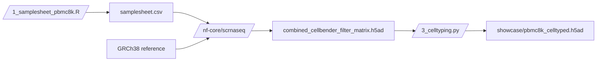

# nf-lamin showcase: cross language data lineage

A minimal, runnable version of the nf-lamin blog post. a samplesheet is built in R, an nf-core/scrnaseq run quantifies public 10x data, and a Python script assigns cell types, with every run and artifact tracked in LaminDB, across all three languages.



## The data

- **Input**: `pbmc8k`, 10x Chromium v2 scRNAseq of ~8k human PBMCs (nf-core/scrnaseq's full test dataset), hosted on the public `s3://ngi-igenomes` bucket. S3 paths stage reliably.
- **Reference**: Ensembl GRCh38 (release 110) genome FASTA + GTF.
- **Cell typing**: CellTypist `Immune_All_Low` model.

## Prerequisites

- Nextflow + Docker
- R with laminr
- Python with `lamindb`, `scanpy`, `celltypist`

## Run

```bash
# 0. Settings: where to track, and where to publish the pipeline outputs
export LAMIN_API_KEY=...                           # from https://lamin.ai/settings
export LAMIN_CURRENT_INSTANCE=my-org/my-instance
export OUTDIR=s3://my-bucket/showcase/scrnaseq_pbmc8k

# 1. Build and register the samplesheet
./1_samplesheet_pbmc8k.R

# 2. Run nf-core/scrnaseq on the lamin:// samplesheet
./2_run.sh

# 3. Assign cell types to the resulting count matrix
./3_celltyping.py
```

## Lineage on LaminHub

Every run and artifact from this showcase, recorded in `laminlabs/lamindata`:

| Step | Transform | Output |
| --- | --- | --- |
| 1. samplesheet (R) | [`1_samplesheet_pbmc8k.R`](https://lamin.ai/laminlabs/lamindata/transform/NKe21Y2XEBIo0000) | [`pbmc8k_samplesheet.csv`](https://lamin.ai/laminlabs/lamindata/artifact/rF7oiknTdhpfqU5H0000) |
| 2. nf-core/scrnaseq | [`nf-core/scrnaseq`](https://lamin.ai/laminlabs/lamindata/run/PXe4TYRvVNcRstzl) | [`combined_cellbender_filter_matrix.h5ad`](https://lamin.ai/laminlabs/lamindata/artifact/SGHdW3cN3QXHJJCz0000) |
| 3. cell typing (Python) | [`3_celltyping.py`](https://lamin.ai/laminlabs/lamindata/transform/cyuZlQ5ua0wJ0000) | [`showcase/pbmc8k_celltyped.h5ad`](https://lamin.ai/laminlabs/lamindata/artifact/JvUll5j4iQDhTobi0000) |

Open the [cell typed artifact](https://lamin.ai/laminlabs/lamindata/artifact/JvUll5j4iQDhTobi0000) for the full lineage graph, or run `ln.Artifact.get(key="showcase/pbmc8k_celltyped.h5ad").view_lineage()`.
