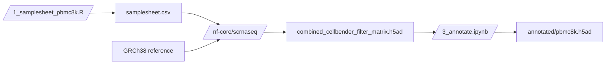

# nf-lamin showcase: cross language data lineage

A minimal, runnable version of the nf-lamin blog post. a samplesheet is built in R, an nf-core/scrnaseq run quantifies public 10x data, and a Python notebook annotates the cells, with every run and artifact tracked in LaminDB, across all three languages.



## The data

- **Input**: `pbmc8k`, 10x Chromium v2 scRNAseq of ~8k human PBMCs (nf-core/scrnaseq's full test dataset), hosted on the public `s3://ngi-igenomes` bucket. S3 paths stage reliably.
- **Reference**: Ensembl GRCh38 (release 110) genome FASTA + GTF.
- **Annotation**: CellTypist `Immune_All_Low` model.

## Prerequisites

- Nextflow + Docker
- R with laminr
- Python with `lamindb`, `scanpy`, `celltypist`

## Run

```bash
# 1. Build and register the samplesheet
./1_samplesheet_pbmc8k.R

# 2. Run nf-core/scrnaseq on the lamin:// samplesheet
./2_run.sh

# 3. Annotate the resulting count matrix
jupyter execute 3_annotate.ipynb
```

## Lineage on LaminHub

Every run and artifact from this showcase, recorded in `laminlabs/lamindata`:

| Step | Transform | Output |
| --- | --- | --- |
| 1. samplesheet (R) | [`1_samplesheet_pbmc8k.R`](https://lamin.ai/laminlabs/lamindata/transform/NKe21Y2XEBIo0000) | [`pbmc8k_samplesheet.csv`](https://lamin.ai/laminlabs/lamindata/artifact/rF7oiknTdhpfqU5H0000) |
| 2. nf-core/scrnaseq | [`nf-core/scrnaseq`](https://lamin.ai/laminlabs/lamindata/transform/PhX5TXQhj3l6wowC) | [`combined_cellbender_filter_matrix.h5ad`](https://lamin.ai/laminlabs/lamindata/artifact/aqOOFyumixTtQNOs0000) |
| 3. annotate (Python) | [`3_annotate.ipynb`](https://lamin.ai/laminlabs/lamindata/transform/MKKPcGfush7g0000) | [`annotated/pbmc8k.h5ad`](https://lamin.ai/laminlabs/lamindata/artifact/hsCH2XBEje5JOZzq0000) |

Open the [annotated artifact](https://lamin.ai/laminlabs/lamindata/artifact/hsCH2XBEje5JOZzq0000) for the full lineage graph, or run
`ln.Artifact.get(key="annotated/pbmc8k.h5ad").view_lineage()`.
